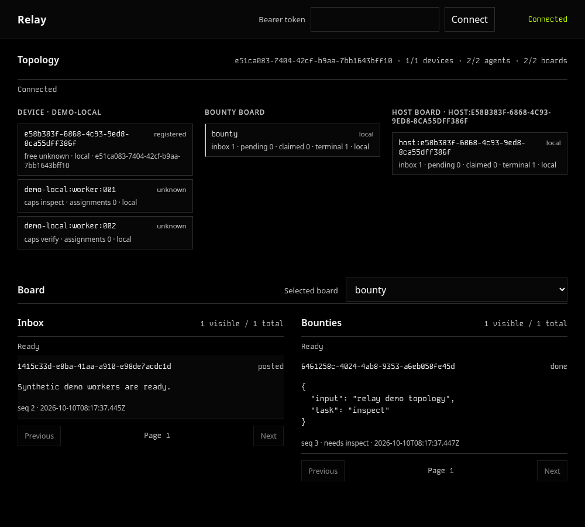

# Relay

## Quick start

```sh
git clone https://github.com/PugzUI/Relay.git
cd Relay
npm ci
npm run demo
```

The demo uses a temporary local store, two synthetic workers, board posts,
claims, persisted acknowledgements, and the resulting snapshot/audit records.
It does not launch an agent runtime or start a network listener. No model
provider or account is needed.

To run the authenticated browser demo, start its disposable loopback listener
in one terminal. This explicit mode defaults to port `4200` and five minutes;
it prints a private token-file path and the capture command, never the token or
a session ID.

```sh
RELAY_DEMO_TOKEN_FILE="${TMPDIR:-/tmp}/relay-demo.token" npm run demo -- --serve
```

In a second terminal, run this while the demo is still running:

```sh
RELAY_CAPTURE_TOKEN_FILE="${TMPDIR:-/tmp}/relay-demo.token" npm run capture
```

Choose another fixed port or bounded duration when needed:

```sh
npm run demo -- --serve --port 4200 --duration-ms 300000
```

`RELAY_DEMO_PORT`, `RELAY_DEMO_DURATION_MS`, and `RELAY_DEMO_TOKEN_FILE` can
also set those values. An existing token destination is refused. The demo
listener binds only `127.0.0.1`, creates private disposable state and credentials,
and removes them when its duration ends or it receives `SIGINT`/`SIGTERM`. Run
`npm run capture` only against that live demo; it uses a fresh temporary browser
profile. Browser capture exercises the local configured path. Physical LAN and
Tailscale qualification remains pending.

## View



[Full-size topology](docs/media/topology.png) ·
[Narrow topology](docs/media/topology-narrow.png) ·
[Narrow board panes](docs/media/board-narrow.png) ·
[Recorded capture metadata](docs/media/capture.json)

The images are captures of the disposable authenticated demo, not mockups.
The bearer field is cleared after connection; credentials stay in memory.

## CLI

Local inspection and mutation use a selected store root. Read commands open it
read-only and do not initialize a missing store.

```sh
node src/cli.mjs setup --root './relay data' --device workstation
node src/cli.mjs register worker --root './relay data' --cap inspect
node src/cli.mjs join workstation:worker:001 --root './relay data'
printf '%s\n' '{"msg":"ready"}' | node src/cli.mjs send workstation:worker:001 --sid SESSION --root './relay data'
```

Replace `SESSION` with the session `id` returned by `join`. A send or board post reads
one JSON envelope from stdin: `{ "msg": "text" }` or
`{ "work": { "task": "inspect" } }`. Text is never classified as work.
`--json` writes compact JSON; normal output escapes terminal control bytes.
Bearer tokens are read from private files and are never command arguments or
URL values.

## API

```js
import { open } from "./src/index.mjs";

const relay = open({ root: "./relay data" });
try {
  const worker = relay.register("worker");
  const session = relay.join(worker.id);
  const receipt = relay.send(session.id, worker.id, { msg: "ready" });
  console.log(receipt.id, receipt.repeat);
} finally {
  relay.close();
}
```

See [API reference](docs/api.md), [storage](docs/storage.md),
[limits](docs/limits.md), [network](docs/network.md), [boards](docs/boards.md),
and [topology](docs/topology.md).

The [recovery example](examples/recovery.mjs) closes and reopens a disposable
store around lease expiry. The [network example](examples/network.mjs) uses
two independent loopback authorities with temporary credentials and a trusted
one-run HTTPS certificate. It produces addressed, bounty, and host-local
acknowledgement receipts through the actual broker/client protocol.

## Delivery and authority

Each store owns its records, board scope, and expiry clock. A hub owns the
shared `bounty` board; each host owns its `host:<device-id>` board. A host may
connect to one configured hub, but databases and queues are not replicated.
The hub never opens a host database.

Accepted enqueue, claim, and acknowledgement state is persisted. A worker can
repeat work after interruption or lease expiry, including after an external
side effect occurred but before acknowledgement. Make external effects
idempotent when duplication matters. A keyed send deduplicates admission during
key retention; it does not provide exactly-once execution.

Relay’s durable queue does not itself invoke an agent session or wake an idle
runtime. Optional native delivery is not implemented or qualified; see the
[delivery contract and client inventory](docs/delivery.md).

## Network and setup

Local setup starts no listener. `serve` is an explicit operation; its default
application port is `4200`. Local HTTP binds literal loopback. LAN mode requires
an explicit local address, TLS trust, and an exact peer allowlist. Tailscale
mode uses loopback behind operator-managed private HTTPS. Credentials and
Relay permissions remain required in every mode. See [network boundaries and
qualification](docs/network.md).

This repository has no LAN or private-network qualification evidence yet.
No setup, example, or demo changes firewall, Tailscale, certificate, proxy, or
service configuration.

## Development

```sh
npm run check
npm test
npm run demo
npm run demo -- --serve
npm run capture
```

`check` validates syntax, declarations, package contents, and frozen module
presence; it does not run tests. `test` is separate. `capture` requires an
actual disposable demo server with connected topology, Inbox, and Bounties
data on loopback (default port `4200`), a private token file, and Chromium
browser. It uses a fresh temporary browser profile and the UI's bearer-token
form. The URL defaults to `http://127.0.0.1:4200`; set `RELAY_CAPTURE_URL` to
select another loopback origin. Set `RELAY_CAPTURE_TOKEN_FILE` to a private
file containing the demo token and `RELAY_BROWSER` to select a browser
executable. Capture fails on authentication, loading, empty board panes, origin
or geometry mismatch, horizontal overflow, browser runtime exceptions, or
unavailable data. A successful run writes wide and narrow topology screenshots,
a narrow board view, and measured browser, runtime, viewport, pixel, board, and
timestamp metadata under `docs/media/`.
The committed captures were exercised against the real local demo. Native
Node.js 24 and 26 checks and regression suites are qualified on Linux; see
[verification evidence and remaining boundaries](docs/verification.md).

The supported runtime contract is Node.js `>=24.0.0` on a local filesystem.
No runtime dependencies are declared. See [acceptance cases](docs/acceptance.md)
and [the frozen contract](docs/contract.md) for implementation and qualification
boundaries. Licensed under [MIT](LICENSE).
